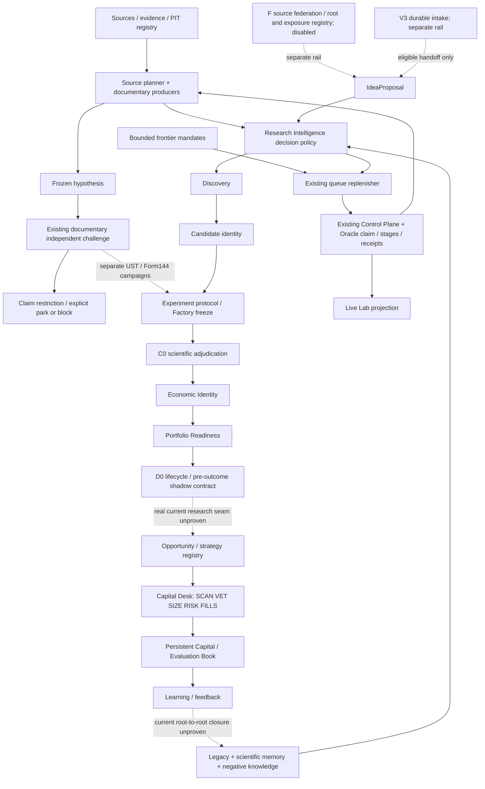

# Current functional machine

This is a graph of recoverable functions, not a declaration of a newly promoted trunk. `W2` means candidate `ebc72b9fd14f91420c37e0b7607f9bfb584a289a`; `R` means operational state `16eafd0b3c8d9e0c633ef01dd191cbd32ae50b42`, which records executable release `a67ffec48fff895d5edc42171855e2213e49cf0d`. A file on W2 is not thereby deployed. F=`79329f15bbf02c25fa61e5d5ef6028e5abfb1493`; V3=`0691a4c1c905c8cfa1e68d521b12d66655ec4dd3`.

Solid arrows describe implemented contracts or witnessed older documentary transitions, **not one observed end-to-end production lineage**. Dotted arrows mark separate campaigns, separate unintegrated rails, or unproved real-object continuity. Scientific C0→Economic→D0 has fixture seam tests; those do not establish a current research outcome. Existing V1 Factory/strategy-registry→Desk→Book→Learning is another implemented rail, not proof that current native V2 candidates traverse it.

## Independent status axes

`YES` means evidence within the stated scope; `PARTIAL` means only the stated subset; `UNKNOWN` means not established. `NO` is used for explicit absence in W2 or disabled deployment. `BROKEN=NO_PROVEN_DEFECT` means no defect demonstrated by this review; it does not certify correctness. `INTEGRATED` concerns W2 plus relevant neighboring contracts, not formal Owner promotion. `DEPLOYED=HISTORICAL` is bounded evidence of historical external use, not a current host probe. The final column names material unknowns, so existence never conceals an integration or runtime uncertainty.

| Stage | EXISTS | QUALIFIED | INTEGRATED | DEPLOYED | OBSERVED_IN_REAL_USE | AUTONOMOUSLY_CONTINUED | BROKEN | BLOCKED | UNKNOWN |
|---|---|---|---|---|---|---|---|---|---|---|
|Source / Evidence / PIT|YES|PARTIAL: registry and provenance contracts|PARTIAL: W2 data + documentary packets|HISTORICAL: R source packets|YES: Apple packet; Form144 source attempt separately|PARTIAL: documentary source selection|NO_PROVEN_DEFECT|YES: quant source absent; SEC403; PIT gaps|Broad admissible data coverage; present host access|
|Research Intelligence|YES|YES: W2 bounded pure policy|YES: W2 ports and policy bindings|UNKNOWN for W2 RI|UNKNOWN for current RI on real roots|UNKNOWN|NO_PROVEN_DEFECT|PARTIAL: route/budget/source gates|Live yield of new RI|
|Frontier generation|YES|YES: bounded derivation tests|YES: replenisher/worker|HISTORICAL: R bounded mandates|YES: 48 issued across four current families|YES: issuance, not unlimited novelty|NO_PROVEN_DEFECT|YES: 4×12 issue caps reached|New cohort transition; scientific search exhaustion|
|Replenishment|YES|YES: bounded queue policy|YES: W2 + existing worker|HISTORICAL|YES: durable frontier tasks|YES: bounded; now NOOP|NO_PROVEN_DEFECT|YES: exhausted and zero runnable tasks|Renewal beyond existing cohort|
|IdeaProposal / passive ideation A/B/C|YES|YES: W2 scoped tests|YES: W2 passive bindings|UNKNOWN|UNKNOWN for current real roots|UNKNOWN|NO_PROVEN_DEFECT|PARTIAL: external backend unqualified|Production novelty/productivity|
|V3 durable intake|YES|YES: branch-scoped CI evidence|NO: separate 2b99-based rail|NO_PROOF|NO_PROOF|NO_PROOF|NO_PROVEN_DEFECT|YES: convergence and live source qualification|Interaction with later W2 and F|
|GIGA F federation / roots / exposures|YES|YES: scoped branch fixture/CAS proof|NO: separate rail|NO: feed explicitly disabled|NO: scientific use not shown|YES_IN_DEMO_ONLY|NO_PROVEN_DEFECT|YES: no qualified live backend; disabled|Real source and novelty yield|
|Discovery|YES|YES: W2 adapted B contracts|YES: W2 producer/Factory bindings|UNKNOWN|NO_PROOF for modern B on 15 roots|NO_PROOF|NO_PROVEN_DEFECT|PARTIAL: qualified input required|Real Proposal→Candidate traversal|
|Candidate identity|YES|YES: schemas/hash and binding tests|YES: W2 B/Factory/C0 contracts|PARTIAL: older hypotheses and V2 trial artifacts in R|YES: frozen older hypotheses; modern CandidateCore use partial|PARTIAL: existing workers freeze roots|NO_PROVEN_DEFECT|PARTIAL: legacy-context reenrollment|Equivalence across older/current representations|
|Factory / experiment freeze|YES|YES: W2 pre-outcome contracts|YES: W2 infrastructure/C0 bindings|PARTIAL: distinct campaign runners|YES: UST protocol; Form144 source attempt|UNKNOWN beyond documentary freeze|NO_PROVEN_DEFECT|YES: UST continuation unclassified; Form144 data block|Generic automatic experiment task creation|
|C0 / scientific adjudication|YES|YES: W2 scoped; latest C0 separate|PARTIAL: W2 older kernel + adapter; latest semantic fix absent|UNKNOWN|NO_PROOF formal C0 on current roots|NO_PROOF|YES_SCOPED: semantic confirmation counted without proven semantic review|YES: no qualified current-root Factory/adjudication bundle witnessed|Final converged semantic independence and production use|
|Economic Identity|YES|YES: structural contracts and fixture seam|PARTIAL: native/shared wire unresolved|UNKNOWN|NO_PROOF on current roots through C0|NO_PROOF|YES_SCOPED_W2: L001 metadata loss reproduced|YES: identity/seam and evidence gaps|One authoritative transport for native/shared objects|
|Portfolio Readiness|YES|YES: structural mapping tests|PARTIAL: W2 EI/D0 fixture binding|UNKNOWN|NO_PROOF for current roots|NO_PROOF|NO_PROVEN_DEFECT at whole-system scope|YES: unknown empirical returns/correlation/capacity|Actual portfolio marginal contribution|
|D0 lifecycle|YES|YES: preserved kernel + W2 adapter tests|PARTIAL: C0/EI/PR pre-outcome fixture seam|UNKNOWN|NO_PROOF current root lifecycle|NO_PROOF|NO_PROVEN_DEFECT|YES: prospective/economic authority closed|Real-object observation/review transport|
|Control Plane|YES|YES: operational + W2 contracts scoped|YES: workers/tasks/claims|HISTORICAL: R|YES: claims/stages/receipts and wakes|YES: bounded documentary stages|PARTIAL: 9 stored task/stage contract mismatches|YES: closed authority + no runnable work|Present host liveness; campaign-specific authority resolution|
|Oracle runtime|YES|YES: historical boot/recovery and saved CI|PARTIAL: R release older than W2|HISTORICAL: a67ffec release witness|YES: recorded wake 2026-10-26 00:50:15Z|YES: polling/older documentary continuation|NO_PROVEN_DEFECT from NOOP alone|YES: bounded queue exhausted|Current process, version and deployment of W2/F/V3|
|Live Lab|YES|YES: projection/reducer tests|PARTIAL: historical SSE bridge|HISTORICAL|YES: saved Oct20 SSE; present host unknown|NOT_APPLICABLE: projection|NO_PROVEN_DEFECT|NO_PROVEN_BLOCK|Current browser/host; no inference of scientific progress|
|Opportunity|YES|YES: V1 replay + W2 code/tests|PARTIAL: Desk rail; current V2 seam unproved|UNKNOWN current host|NOT_PROVEN: replay is qualification only|YES_IN_REPLAY_ONLY|NO_PROVEN_DEFECT|YES: no qualified current-root strategy transport|Real research lineage into StrategyRegistry|
|Capital Desk|YES|YES: bounded replay, stage and journal tests|YES within V1 rail; PARTIAL overall|UNKNOWN current host|NOT_PROVEN: only controlled replay recovered|YES_IN_REPLAY_ONLY|NO_PROVEN_DEFECT|YES: real capital/live trading prohibited|Actual executable edge, liquidity/costs and authority|
|Book / Evaluation Book|YES|YES: persistence/restart replay|YES within Desk rail; PARTIAL overall|UNKNOWN current host|NOT_PROVEN: replay only; capital 0 fills, evaluation nonzero|YES_IN_REPLAY_ONLY|NO_PROVEN_DEFECT|YES: no real capital authorization|Real broker assets/positions; current-root shadow chain|
|Learning / Feedback / Memory|YES|YES: V1 feedback + scientific memory tests|PARTIAL: multiple contract paths exist|PARTIAL: negative documentary memory in R|YES: duplicate/negative dispositions; V1 feedback replay|PARTIAL: documentary rejects; full new-root feedback unknown|NO_PROVEN_DEFECT|PARTIAL: incomplete historic exposure/denominator binding|Current Research→Book→Memory→new root closure|

## Primary evidence map and checks

All following references were inspected as exact Git objects; matching snapshots are retained in the frozen audit package. `path:line` denotes the start of the cited function or record, not a claim that a passing test covers all reachable behavior.

| Ref | Primary object and what it establishes |
|---|---|
|M01|W2 `research/research_os/research_intelligence.py:388` `decide_candidate`, `:584` `evaluate_search_space`, `:613` `classify_frontier`, `:658` `choose_next_action`: decision/identity/route policy already exists.|
|M02|W2 `research/research_os/queue_replenisher.py:133` `derive_refill_task`: at most one bounded producer task, global-empty requirement, max-issued eligibility; `:461` `derive_from_repo`.|
|M03|R `research/research_os/runtime/RESEARCH_FRONTIER.json`: four enabled documentary families, cap12, authority all false. R `runtime/worker_wakes/20261026T005015Z-731d00139b.json`: 72 terminal tasks, 0 ready/claimed, release a67ffec, NOOP, writes0, model calls0. This is a durable observation, not a fresh remote probe.|
|M04|W2 `research/research_os/worker_stages.py:59` stage plan, `:75` stage authorization, `:204` executor; `oracle_worker.py:63` worker; `oracle_worker_v2.py:36` V2 worker. Task/stage dispatch exists before a proposed new orchestrator.|
|M05|W2 `research/research_os/multi_source_ideation.py:125` A, `:141` B, `:169` C, `:272` intake, `:282` passive ledger. V3 `ideation_intake.py:713` durable ledger, `:973` narrow `discovery_handoff` explicitly returns `candidate_created=False`.|
|M06|F `research/research_os/idea_feed/feeder.py:65` derive request, `:114` replenish, `:131` execute stage; `runtime/IDEA_FEED_POLICY.json` disabled; `GIGA_F_FINAL_MANIFEST.md` states fixture limits and absent qualified external runtime. Fixture federation is not independent scientific discovery.|
|M07|W2 `research/research_os/discovery_engine.py:289` `build_discovery_handoff`; `expansion/v2_core.py:191` `build_candidate`; `expansion/final_shape.py:24` freeze; `expansion/v2_bridge.py:25` producer adaptation.|
|M08|W2 `expansion/scientific_adjudication.py` explicitly preserves historical C0 blob `3f0e1b7…`, adds a canonical membrane and denies runtime/economic ownership. Current C0 source `6dc84f…` semantic-independence patch requires separate reconciliation.|
|M09|W2 `expansion/final_shape.py:131` Economic Identity; `portfolio_v2.py:265` structural identity and `:591` diagnostics; `economic_test_readiness_v1.py:213` creates identity; `expansion/wave2_scientific_economic_bridge.py:38` binds existing refs and `:148` creates only pre-outcome D0 shadow. W2 tests `test_wave2_c2_scientific_economic_d0_seam.py:213` use constructed fixtures.|
|M10|W2 `expansion/economic_lifecycle.py` preserves D0 kernel and rebinds immutable base; `_economic_lifecycle_d0.py:298` shadow contract, `:431` initial state, `:486` shadow-book projection, `:642` review transition.|
|M11|W2 `src/quant/desk/desk.py:47` CapitalDesk, `:61` zero-authority evaluation ledger and `:74` session; `src/quant/book/ledger.py`; `src/quant/learning/store.py:56` research lessons and `:84` rejection assessment. Code explicitly supports the same chain on evaluation ledger.|
|M12|W2 `research/research_os/live_lab_contract.py`: labels canonical facts only, cannot create work/economic progress; `live_ui_metadata` is an allowlist.|

Saved exact-head CI log at frozen audit `evidence/logs_canonical_full.txt` shows cumulative checks and bounded replay; line3875 emits `WAVE2_INTEGRATED_SHA_EMITTED=FALSE`. This corroborates qualification of candidate ebc, while its manifest's `SAFE_TO_SEAL` is not itself Owner promotion. A fresh metadata-only probe reproduced H L001 on exact W2 and showed Q preserves the four fields on its synthetic fixture path; see [probe](evidence/capital_identity_probe.json) and `06_RESEARCH_TO_CAPITAL_ANALYSIS.md`. D0 shadow Book is identity/lifecycle only, whereas Desk has a separate position/evaluation ledger. Its supported StrategySpec is narrower than event/futures research, so the dotted D0→Opportunity seam includes executable-expression transport as well as identity and authority. No new market outcome was read.

## Challenge to an overly simple audit reading

The audit is right to separate deployed old runtime, W2 candidate and distinct F/V3 rails. Its repeated `IMPLEMENTED;TESTED` labels do not establish deployment or current-root use. Conversely, lack of a current profitable research chain cannot justify calling Factory, Desk, Book, Learning, source planning or scheduling absent: the inspected code implements them. The most material unknown is the identity-preserving, authority-aware traversal between these existing owners. `NOOP_FRONTIER_EXHAUSTED` is legitimate behavior under the pinned bounded policy; it is not evidence of scheduler death or exhausted scientific opportunity.
