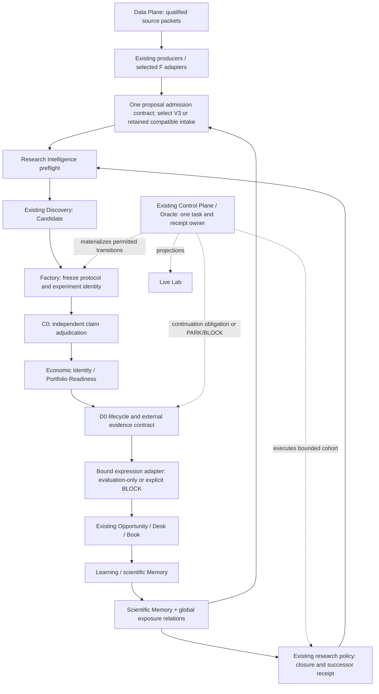

# Minimal target: existing owners, explicit policy and handoff seams

Choose **Option E**, staged so the next authorized build can stop after each witness. Its immediate minimum is targeted integrity/convergence plus explicit continuation dispositions; its next autonomous-search delta is a versioned successor-cohort policy. A generic Advanced Research subsystem is unnecessary on present evidence. No product change is implemented by this review.

Arrows specify target contracts; they are not claims that all current arrows are deployed or proven in real use. D0 consumes qualified external evidence references, not raw outcomes; the external evaluator remains behind a separate authority membrane. Metadata transport and synthetic zero-authority evaluation can be proved now; a measured real-root economic success cannot be fabricated.

## Challenge against a zero-new-architecture baseline

Option Z in 09 uses targeted recovery, authority normalization, source qualification and lawful task configuration only. It is the first diagnostic action: it may resolve UST or a source park without new code. It cannot by configuration repair the reproduced W2 confirmation-count mismatch or frozen-metadata loss; nor has it shown an immutable successor transaction that prevents budget/exposure reset. Those functions motivate selective existing repairs and thin seam contracts. If targeted recovery finds equivalent controls, existing valid dispositions or a qualified successor mechanism, omit the corresponding new contract. Option E is the smallest supported complete target under current evidence, not a mandate to write every listed adapter before trying existing machinery.

## Component dispositions

| Component | Disposition | Smallest action and boundary |
|---|---|---|
| Source/PIT/evidence owners | KEEP_AS_IS; CONVERGE | Keep primary source truth and clocks. Recover off-rail source dispositions. Add an adapter only for a selected real missing packet, not a new Data Plane. |
| Research Intelligence | KEEP_AS_IS; REPLAY_TESTS | Reuse preflight/memory/search-completeness judgments; no new manager or outcome access. |
| Research OS frontier/source planner | KEEP_AS_IS; REPAIR | Reuse unused-packet selection. Make source consumption/identity continuous across cohort versions; fix typed stage contract where authorized. |
| Cohort renewal | NEW thin contract | Append closure/successor receipt inside research policy; existing Control publishes it. Fixed initial allocation, cumulative budgets/exposure, explicit policy information cutoff. No new scheduler. |
| Multi-source policies / F | PORT selectively; CONVERGE | Reuse needed source/root/exposure/budget primitives. Keep fixture/external-model feed disabled until an actual source is qualified. Do not merge all origins to claim diversity. |
| V3 / existing proposal intake | CONVERGE; RETIRE competing write ownership | Select one versioned admission ledger contract; map F/legacy IDs. Keep history and read projections; retire duplicate active writes only after equivalence/replay. Selection need not block a narrow UST metadata recovery. |
| Discovery / Candidate | KEEP_AS_IS; CONVERGE | Existing candidate synthesis/identity owns proposal-to-Factory handoff. Prove one real proposal witness or documented rejection; no replacement Discovery. |
| Factory / experiment / freeze | KEEP_AS_IS; REPAIR seam | Existing freeze/trial owners; add only typed next-disposition obligation after freeze and source readiness. Do not reclassify a mechanism screen as executable profitability. |
| Positive continuation | REPAIR; NEW narrow obligation contract | Existing Control/worker transitions emit one next task/result or explicit blocked/park receipt with unblock predicate. No general new orchestrator. |
| C0 | PORT; REPLAY_TESTS | Reconcile semantic confirmation counting repair with W2 adapter, preserving broader W2 controls and genuine producer/challenger separation. Assertions alone do not establish independence. |
| V2 forward CP080–099 | PORT named controls; REPLAY_TESTS | Reconcile missing composed proposal/generated-at/model checks and native equivalents; no wholesale old-file replacement. |
| Q / H / V / longitudinal findings | REPLAY_TESTS; PORT relevant repair | Reproduce L001 and legacy-review transport; use Q repair where applicable; triage attacks semantically. Q is not whole-system qualified; old replay failures are not independent defects. |
| Economic Identity / Portfolio | CONVERGE; REPAIR | One lossless typed native/shared projection with frozen cashflow/instrument/universe/clock/horizon and UNKNOWN/provenance preserved. Structural readiness never invents correlation. |
| D0 / prospective lifecycle | KEEP_AS_IS; CONVERGE | Preserve lifecycle/observation identities and external evidence references. D0 shadow state is not a capital position ledger. Authority remains separate. |
| Opportunity / Desk / Book | KEEP_AS_IS; NEW adapter only if selected expression requires it | Use EVALUATION path for synthetic test; current signal language cannot silently substitute for UST/events/futures. Unsupported expression emits typed BLOCK. No new capital system. |
| Learning / Memory | KEEP_AS_IS; CONVERGE | Existing stores own outcomes/verdicts; add cross-owner ID joins and feedback dispositions. No second memory database. |
| Research-process denominator | NEW derived join contract | Join F/V3/native trials/Factory/results/memory without changing owners. Preserve attempted/admitted/tested/positive/park/kill/duplicate/data-block distinction and UNKNOWN historical coverage. |
| Control Plane / Oracle | KEEP_AS_IS; REPAIR transitions; CONVERGE release | Existing clock, leases, recovery and task publication. Qualification and deployment require exact SHA/release evidence. Never create a second runtime. |
| Live Lab | KEEP_AS_IS; CONVERGE projections | Display receipt-backed exhaustion/blocked/due work and installed SHA. UI is not scientific or authority truth. |
| New top-level Advanced Research | RETIRE proposal for now | No exclusive missing responsibility beyond existing policy and the thin successor contract. Reconsider only after controlled measurement. |
| Historical rails/positives | KEEP_AS_IS immutable; CONVERGE references | Preserve experiments, exposures, negative evidence and valid parks; no retrospective re-registration or bulk reactivation. |

REPLACE: **none justified**. RETIRE refers to duplicate future write ownership or an unneeded proposal, not deleting historical evidence or branch refs.

## Invariants and practical limit

All changes must preserve fail-closed authority, outcome isolation, PIT, trial/exposure accounting, negative knowledge, identity continuity, frozen protocols and duplicate suppression. Real capital and live trading remain false. A source problem can legitimately end in PARK_DATA; a claim restriction can legitimately prevent handoff; a successor cohort can legitimately emit no work.

The target improves the chance that genuine ideas are tested and continued by eliminating silent loss and repeated known infeasibility. It cannot create a qualified source, remove access restrictions, prove unobserved independent review, make low-capacity expressions tradable, or promise economic discovery. Measurement must be capable of finding that the selected research policy produces no useful edge.
