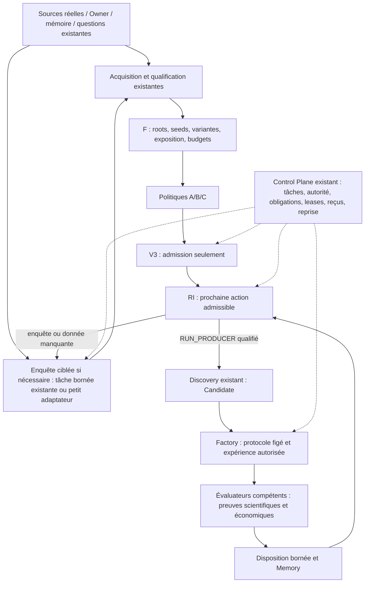

# Delta architectural minimal — recommandation bornée

STATUS=FUNCTIONAL_RECOMMENDATION_NOT_A_BUILD
AUDIT_COMPLETENESS=INCOMPLETE
PRESERVED_AUDIT_SHA=f503b5f070bda6a61824d139ba8bb7b026892ebe
ANALYSIS_DATE=2026-10-26
PRODUCT_CODE_MODIFIED=FALSE

La recommandation la plus parcimonieuse étayée par les objets examinés est de fermer une boucle de recherche durable avec les composants existants. Il faut d'abord réconcilier les contrôles qualifiés, puis rendre explicite et vérifiable la continuation entre leurs propriétaires. Une capacité d'enquête ciblée peut compléter l'alimentation en preuves si aucun exécuteur existant ne la couvre. Cela ne nécessite pas, à ce stade, un nouveau Research OS, un nouveau Discovery, un second ordonnanceur ou un onglet Advanced Research.

Cette recommandation n'est pas une preuve que cette architecture maximise un rendement économique. Le rendement comparatif des sources et la nécessité globale d'un nouveau composant restent UNKNOWN_DUE_TO_MISSING_DENOMINATOR / UNKNOWN_DUE_TO_INSUFFICIENT_EVIDENCE. L'audit historique n'est pas clos. La littérature du premier prompt n'a pas fait l'objet d'une nouvelle investigation pendant cette analyse.

## 1. Ce qui est établi

FACT_PROVEN, dans les portées figées et citées dans SOURCE_BINDINGS.json :

- Le corpus Oracle de l'audit contient 15 hypothèses gelées, et pas zéro idée. Le total historique distinct demeure UNKNOWN.
- Ses 38 tâches bloquées se répartissent en 18 doublons courants, 10 sources documentaires quant manquantes, 9 refus d'étape sur les contrats de tâches de flux et 1 contexte historique exigeant un nouvel essai V2. Ces causes n'appellent pas la même réponse.
- V3 fournit une admission durable bornée qui s'arrête à ELIGIBLE_FOR_DISCOVERY. Il ne crée ni Candidate ni tâche d'expérience.
- F possède déjà un registre root/seed/variant/exposure, des budgets, une santé de frontière, de la contre-pression et des tâches de source dans le Control Plane existant. Sa configuration qualifiée est désactivée et repose sur des fixtures.
- L'exécuteur F finit sa tâche de source après les politiques/intake passifs. Sa fonction séparée discovery_from_proposal exige une décision RI RUN_PRODUCER ; le succès de sa démonstration technique ne prouve pas une continuation de production automatique.
- Les sources F consomment des paquets figés. L'acquisition réseau appartient au plan données/source existant. Remplacer deux paquets Apple par un LLM commentateur n'est pas une preuve d'alimentation distincte.
- Des continuations sont déjà implémentées : worker_stages crée sous conditions un enfant de validation puis un enfant d'intégration pré-outcome. Oracle publie les écritures et reçus par transaction Git. Il serait faux de dire qu'aucun handoff ou aucune atomicité n'existe.
- Form144 a un protocole, une admission et une tentative réelle arrêtée par SEC403 avant outcomes. UST a un protocole figé, mais son exécution attendue n'est pas retrouvée et sa portée d'autorité reste contradictoire. Un PASS documentaire n'est donc ni une expérience exécutée ni un edge.
- Le dernier C0 et les contrôles V2 tardifs de sujet/modèle/fenêtre ne sont pas tous dans Wave2. Q n'est pas qualifié. La composition et le déploiement doivent rester des qualifications distinctes.

Les HEAD W2, F, V3 et Q ont été relus sur GitHub pendant cette analyse et correspondent aux SHAs de la passe préservée. Cela ne constitue pas une nouvelle inspection du processus Oracle distant ni de tout l'historique.

## 2. Décomposition du plus petit delta

### A. Dette à fermer : composer et qualifier l'existant

Réconcilier V3, F, le dernier contrôle d'indépendance C0 et les contrôles V2 tardifs sur une cible déclarée. Leurs qualifications de branche ne s'additionnent pas en qualification de la composition. Les corrections Q et attaques H/V/L sont à reprendre selon leur pertinence ; ne pas fusionner Q en bloc alors que sa qualification obligatoire échoue, ni copier des fichiers historiques par-dessus les versions plus développées.

Ce travail est une dette d'intégration et de qualification. Il ne justifie aucun remplacement de la Factory, de la Scientific Memory, du Control Plane ou de Discovery. La liaison Economic Identity native/partagée doit avoir un propriétaire établi avant d'affirmer la continuité économique.

### B. Delta transversal : une obligation de continuation dans le Control Plane existant

Pour chaque disposition nécessitant une suite, la transaction canonique doit conserver soit la référence de la prochaine tâche et de son propriétaire, soit un arrêt explicite avec condition de réouverture. La réussite n'est pas « un champ handoff_created=true » mais un descendant retrouvable, exécuté lorsqu'il est admissible, et lié à son résultat.

Le contrat est fonctionnel, pas une nouvelle base de données :

- sujet et génération existants ; référence exacte à l'artefact amont ; portée de claim ; contexte d'exposition ;
- prochaine étape requise et propriétaire ; préconditions de données, capacité, budget et autorité ;
- référence de tâche durable ou blocage/parking motivé ; condition de réouverture observable ;
- clé d'idempotence et reçu de publication/reprise ; lien au résultat enfant quand il existe.

Réutiliser les identifiants F, V3 et Scientific Core au moment où leur owner les crée. Un Candidate ID ne doit pas être injecté dans le payload upstream V3 qui l'interdit. Les arêtes de lignée relient les objets ; elles ne déplacent pas leurs responsabilités.

Étendre les handoffs/leases/reçus/outbox déjà présents, seulement là où le trajet utile manque. Aligner les contrats tâche/capacité/étape ; ne pas ouvrir une permission à partir d'une simple reformulation textuelle. Le réconciliateur existant peut signaler une obligation non satisfaite ou reprendre une publication perdue ; il ne peut pas inventer une autorité, contourner un veto ou relancer une hypothèse sous un autre nom.

ELIGIBLE_FOR_DISCOVERY reste une permission d'être examiné. La RI doit encore établir une action admissible ; elle peut conclure à une enquête, un besoin de données, un parking ou NO_ACTION. Un positif documentaire avec un blocage de claim ne déclenche pas automatiquement un test économique.

### C. Delta d'alimentation : traiter une question, pas recycler un paquet

Brancher en priorité un petit nombre de sources réelles déjà admissibles sur la chaîne données → paquet qualifié → F → politiques → V3. Une nouvelle version de source doit apporter un fait ou une observation distincte ; changer un cohort, un modèle ou un nom ne remet pas les expositions et budgets à zéro.

S'il manque effectivement un exécuteur capable d'obtenir les preuves nécessaires, ajouter une tâche ordinaire d'enquête bornée aux lanes existantes. Ce manque global n'est pas prouvé par l'audit incomplet : il faut d'abord rechercher/raccorder les adaptateurs et capacités de données/source déjà construits.

Entrée : question ou blocage précis, références connues, champ d'investigation, droits d'accès et budget. Sortie : paquet/dossier sourcé, contradictions et résultats négatifs connus, disponibilité/PIT/incertitudes, expérience discriminante proposée et éventuellement un Idea Seed. Un seed repasse par V3 ; il n'est ni un Candidate ni un verdict. La qualification du paquet appartient aux contrats données/source, et non à l'assurance verbale du modèle.

L'enquête peut utiliser un LLM comme assistant. Ni un modèle externe ni un corpus immense ne sont requis pour le premier témoin. Une capture primaire admissible, une question de réplication ciblée ou un gap de mémoire peuvent suffire. Leur productivité comparative doit être mesurée prospectivement ; aucune supériorité économique de l'un de ces moteurs n'est établie ici.

Un sous-système autonome Advanced Research et un nouvel onglet ne sont pas justifiés par ces seuls faits. L'enquête est une capacité de travail ordinaire, à composer avec la provenance et la mémoire existantes. L'Owner doit voir la question, les preuves, le blocage, le prochain descendant et le coût dans une projection de la vérité canonique.

## 3. Architecture cible minimale

Toutes les flèches de cette figure sont une recommandation à qualifier, pas une affirmation de lignée de production déjà observée. C0 conserve son rôle sur les références/provenances compétentes ; il ne devient pas un nouveau lecteur de rendements bruts. Une évaluation économique ne vient pas des politiques, de l'intake ou d'un LLM qui lit une source.

## 4. Autorité, contamination et arrêt utile

Une autorité de recherche peut être déléguée une fois pour un programme borné, avec sources/actions/budget/expiration explicites. Son existence doit être prouvée ; cette note ne l'accorde pas. Une autorité d'expérience ne donne pas une autorité de capital. Le conflit UST est à résoudre avant toute nouvelle acquisition d'outcome.

Conserver la distinction entre capture PIT et indépendance de la découverte. Connaître un résultat publié, un ancien payoff ou une expérience de la même famille doit rester enregistré. Le feedback scientifique peut informer l'exploration future sans faire passer un nouvel essai exposé pour une confirmation indépendante. Les données d'évaluation réservées restent isolées suivant le protocole.

Ralentir ou arrêter sur backlogs, doublons, source indisponible, budgets atteints, capacité indépendante absente ou condition de réouverture non satisfaite. Réutiliser la contre-pression F ; ses capacités configurées ne sont pas une preuve de capacité effective. Zéro idée valide est un état légitime, mais un arrêt doit nommer ce qui manque et ce qui pourrait changer la décision.

## 5. Première mission utile et mesure du progrès

MISSION_PROPOSÉE=CONVERGENCE_ET_CONTINUITE_AUTONOME_VERIFIEES

1. Déclarer une cible exacte et qualifier les contrôles/scientific seams réutilisés.
2. Fermer la lignée UST par une exécution légitime existante retrouvée, un parking/blocage explicite, ou une continuation ultérieure autorisée — sans retuner son protocole ni reconstruire le passé.
3. Faire traiter un paquet primaire réel distinct des paquets Apple fixes, avec enrôlement et exposition avant sélection. Prouver soit un rejet motivé, soit une vraie transition V3 → RI → Discovery.
4. Pour un sujet réellement admissible, prouver protocole figé → tâche d'expérience → exécution/résultat → adjudication compétente → mémoire. Un blocage légitime ferme le témoin de disposition, mais ne valide pas les étapes d'expérience restées non exécutées.
5. Sur ce trajet, prouver absence de double tâche/double essai après crash, reprise ou doublon ; absence de promotion ou d'autorité implicite.

L'acceptation ne dépend pas d'un résultat positif. Un résultat nul/négatif, une donnée réellement indisponible ou une falsification correcte sont informatifs. Un arrêt purement technique résolu n'est pas une réfutation économique. Un test historique réussi ne devient ni une preuve prospective ni une valeur de portefeuille ni une autorisation live.

Mesurer d'abord : continuations admissibles réellement exécutées, orphelins, temps/cause d'attente, coût par expérience informative, décisions testables, roots/variantes/trials et leur cohorte. Les taux OOS, prospectifs, nets de coûts et la valeur de portefeuille deviennent interprétables plus tard, avec délais d'observation et population explicités. Aucun classement de source par nombre de propositions n'est défendable.

## 6. Ce qu'il ne faut pas construire maintenant

- Un nouveau Discovery, Candidate model, Proposal Ledger ou ordonnanceur.
- Un second dénominateur qui remplace les registres F/V3/nativeV2 au lieu de les relier.
- Une fédération de dizaines d'agents/sources avant la preuve des continuations utiles.
- Une recherche numérique massive ou des nouvelles données coûteuses avant la qualification d'une question et de son trajet d'évaluation.
- Une promesse de « découverte autonome d'alpha » tirée d'une CI technique ou de sept fixtures.
- Une refonte UI ou une ouverture du capital pour résoudre une dette de recherche.

CONFIDENCE_REUSE_EXISTING_CAPABILITIES=HIGH
CONFIDENCE_EXACT_GLOBAL_MINIMUM_DELTA=MEDIUM
SOURCE_PRODUCTIVITY=UNKNOWN_DUE_TO_MISSING_DENOMINATOR
ECONOMIC_IMPROVEMENT_MAGNITUDE=UNKNOWN_DUE_TO_INSUFFICIENT_EVIDENCE

La priorité est donc une preuve de circulation et de traitement de vraies questions, avec un petit complément d'acquisition/enquête si nécessaire. Le nombre de modules n'est pas le critère ; la capacité de produire un prochain résultat informatif, de s'arrêter correctement et de préserver sa lignée l'est.
