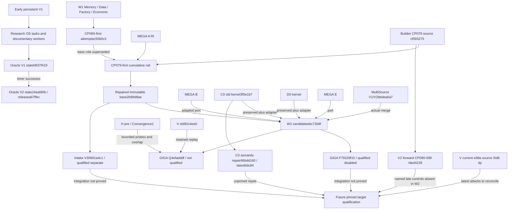

# Supersession and reuse graph

An arrow states a particular succession, port or reuse relation. It does not imply complete semantic integration or authority transfer. Unknown historical supersession remains explicit in the branch ledger.

FACT_PROVEN: F/Q parentage, V3's base, actual MS merge, named byte-preserved ports and late control differences. STRONG_INFERENCE: the FUT node is a dependency order for later work, not an existing build. E01/E19/E25.

| Older object | Successor / retained role | Evidence that must survive |
|---|---|---|
|CP069-first |CP079-first/2b99 replaces its base role |Old qualification/failure scopes remain useful |
|97165db2 |Historical C0/D0 base;2b99 is later Wave2 base law |Qualified source adapted, not blindly overwritten |
|CP079-era composed controls |Forward CP080–099 adds later controls; W2 did not absorb all |Before/after attacks, subject/model/time guards and source qualification |
|MultiSource policies interpreted as independent sources |Passive V2/V3 admission and F distinguish policies/origins |A/B/C remain policies; no measured independent source productivity |
|Earlier V replay-depth claims |Current corrections and rebuilt038–046/061 |53 rejected labels,46 repair groups and CP039 no-defect proof remain distinct |
|V completion claim |Current phaseA incomplete / Owner stop046 |Scoped repairs and attack cases, not an invented CP100 pass |
|H L001 |Q10 partially addresses metadata transport |Original probe still required on final target |
|V LONGITUDINAL_001 |Q04 adds a legacy-review guard |Original truth-transmission counterexample |
|Oracle V1 timer |V2 timer/boot lineage |Old hypotheses/receipts/exposure, without enrollment reset |
|Parallel Fast3ujgeu |STOP_OWNER and unified0ydmkg |Imports, trial charges, timestamp correction and local-ID mapping |
|VXv1 reader failure |v2 reader repair under the same economic expression |Old failure and exposure retained; no independent-trial inflation |
|C0 preserved old kernel |Later qualified C0 remains unported |Semantic-independence policy must be reconciled explicitly |
|Future GIGA F prompt |A real qualified partial build now exists |Reuse its code/contracts/accounting before authorizing any replacement build |

Q has not replaced W2: Q fails its final qualification. V3 has not replaced the entire cumulative system: it is upstream and based on an earlier immutable base. Deployment is not inferred from either branch name.
