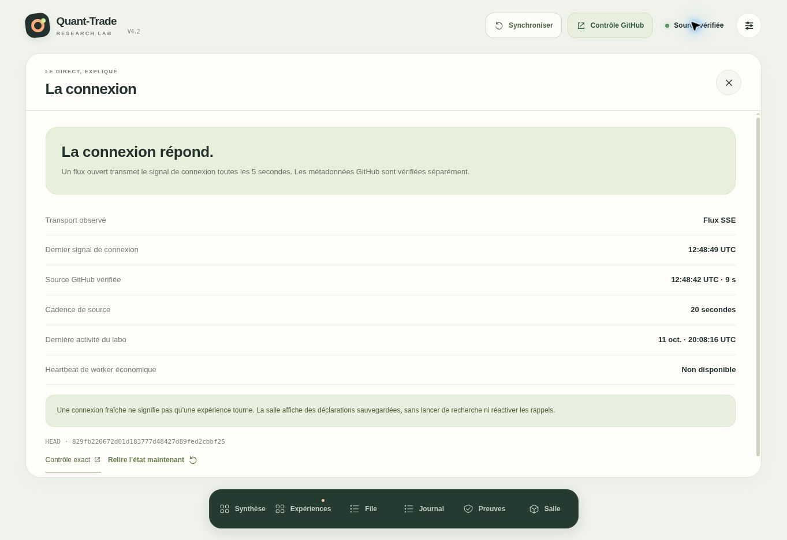

# SITE_E2E — Platform publication repair — 2026-10-12

SITE_E2E = PASS

## Exact platform readback and repair

- Project: `appgprj_6aca43cb86bc81918e067097356a37de`; exists and is active.
- Slug: `quant-trade-lab`; bound to the same project.
- Public URL: https://quant-trade-lab.sassylime.chatgpt.site/
- Initial active production deployment: `appgdep_6acca3c5abe08191b7fd6b5face9e830`, succeeded; saved version 11, source `f8c80aa275f4c0266f2991275475340e32029f7f`.
- Initial audience: `custom`, owner only, access revision 1.
- Root cause 1: platform audience blocked anonymous requests.
- Native access repair: `public`, revision 2, backend timestamp `2026-10-12T12:37:20.376987+00:00`.
- After this repair, unauthenticated root served HTTP 200 and recognizable application HTML. The browser still displayed “Connecte-toi à ChatGPT…”; unauthenticated `/api/state` and `/api/live` returned 401.
- Root cause 2: the existing Worker separately required visitor identity for these two read-only routes.
- Source repair: remove only those two redundant identity checks. Sites dispatch continues to enforce the project's audience. MCP tool calls still require identity; HTTP write routes are absent.
- Same source repository, new saved version 12, source `e3076b9e711ac32c1298ce372dac959939cdc23e`.
- Active repaired deployment: `appgdep_6accd5dc916881918ccf995b153e52d4`, `succeeded`, backend timestamp `2026-10-12T12:43:21.915592+00:00`.
- Final get_site confirmed the same active project, same slug, same production URL, public access, latest version 12.
- No slug change, replacement Site, frontend redesign, framework change, environment-variable change, or scheduler operation.

## Public and rendered verification

All command-line public probes used ordinary HTTPS requests without a cookie jar, authentication header, or Sites bypass token.

- Root: HTTP 200; title `Quant-Trade · Recherche`.
- Read-only state: HTTP 200, `stale=false`; observed source HEAD changed from `b93ff746d6b4522a0e3de3e4c9dd847acf5a2a53` to the canary below.
- Anonymous SSE: HTTP 200, `text/event-stream; charset=utf-8`; actual `connected` and `snapshot` events.
- SSE snapshot: source `829fb220672d01d183777d48427d89fed2cbbf25`, `observed_at=2026-10-12T12:48:42.769Z`, `stale=false`.
- The SSE probe deliberately ended after eight seconds; curl exit 28 is the expected bounded-stream timeout, not an HTTP failure.
- Real public browser rendered current lab data and the exact canary in both **Preuves / LA SOURCE COURANTE** and **La connexion / HEAD**.
- Public screenshot captured at `2026-10-12T12:48:54.210Z`; it shows source verified at `12:48:42 UTC`, a 20-second source cadence, and the full canary HEAD.

## One display-only canary

CANARY_KIND = DISPLAY_ONLY_SOURCE_HEAD_BEACON

CANARY = `829fb220672d01d183777d48427d89fed2cbbf25`

The canary is the exact GitHub commit SHA of the one observability-only marker addition. Its representation and public field were declared in the marker before observation. `SITE_CANARY_20261012_1246_6DCE23A9` is the run label, not the value claimed visibly rendered.

- Marker: `research/edge_lab/e2e/site/SITE_CANARY_20261012_1246_6DCE23A9.json`.
- Canonical branch: `research/edge-lab-continuous`.
- GitHub commit timestamp: `2026-10-12T12:45:33Z` (authoritative; the marker's manually supplied planned timestamp is not used for freshness).
- Exact commit diff contains only this marker file.
- Normal path: GitHub branch push → deployed Worker Git ls-refs → immutable metadata snapshot → existing SSE/HTTP transport → existing source-HEAD text in the public UI.
- This is dynamic data propagation through the existing deployed observer; it needs no artificial hardcoded canary or extra Site redeployment.
- Freshness here is explicitly the source observer's HEAD and observation timestamp. No new LIVE generation, research-worker heartbeat, market activity, or economic execution is inferred.
- The marker remains explicitly classified `DISPLAY_ONLY` and `E2E_TEST_ARTIFACT`.

## Scope and validation

Site source files changed:
- `worker/server.mjs`
- `worker/index.js` (generated Worker)
- `test/server.test.mjs`
- `README.md`

Quant-Trade canonical source change:
- the single E2E canary marker only.

This evidence branch additionally records this report and the public screenshot; it does not advance the observed canonical branch.

Validation: all 35 existing/updated Site tests pass; production build and artifact syntax/export validation pass. The access regression asserts anonymous state reads, anonymous SSE snapshots, continued authenticated MCP calls, and absence of HTTP control writes.

AUTHORITY_UNCHANGED = true

CONTROL readback: real_capital_authorized=false; live_trading_authorized=false. No STATE.json, CONTROL.json, LIVE.json, Discovery/V4.2/V3 code or data, economic result, claim, scheduler, or telemetry generator was modified by this repair.
